# Informe EDA: ventas_sample.xlsx

Fuente (solo lectura): `datos/ventas_sample.xlsx`. Generado: 2026-10-29 16:50 (Europe/Madrid).

El Excel original no se ha modificado. El CSV es una copia con nombres y textos recortados, textos vacíos a nulo y el marcador `#` a nulo.

## 1. Vista general

Hojas (2): `datos` (553465×9), `info` (0×1).

### Hoja `info`

Hoja de documentación: entra en la vista general y no en el resto del EDA.

- Filas: 0. Columnas: 1.

La hoja no tiene filas.

### Hoja `datos`

- Filas: 553465. Columnas: 9. Numéricas: 7. Categóricas: 1. Fechas: 1.

Primeras filas:

Columnas 1 de 2 (Detallista … Margen).

| # | Detallista | Establecimiento | Distribuidor | Material | Week-Month-Year | Litros | CantidadUMB | Margen |
| --- | --- | --- | --- | --- | --- | --- | --- | --- |
| 1 | 115538 | 6000989868 | 100423 | ED11TC13 | 2025-11-24 00:00:00 | 600.0 | 600 | 791.59 |
| 2 | 117117 | 6000008863 | 100423 | ED11TC13 | 2025-03-31 00:00:00 | 979.0 | 979 | 405.89 |
| 3 | 118511 | 7000008478 | 100423 | ED30 | 2025-06-23 00:00:00 | 60.0 | 2 | 132.06 |
| 4 | 118747 | 6000008985 | 100423 | ED11TC13 | 2025-01-20 00:00:00 | 598.0 | 598 | 774.94 |
| 5 | 118747 | 6000008985 | 100423 | ED11TC13 | 2025-09-29 00:00:00 | 600.0 | 600 | -233.09 |

Columnas 2 de 2 (VentaNeta … VentaNeta).

| # | VentaNeta |
| --- | --- |
| 1 | 1044.0 |
| 2 | 817.7 |
| 3 | 170.4 |
| 4 | 1040.52 |
| 5 | 19.31 |

## 2. Tipos de variables

Las columnas numéricas incluyen códigos si el Excel los guardó como número. La nota de baja cardinalidad señala las que tienen 15 valores distintos o menos.

### Hoja `datos`

Numéricas:

| Variable | No nulos | Media | Desv. típica | Mín. | P25 | Mediana | P75 | Máx. | Nota |
| --- | --- | --- | --- | --- | --- | --- | --- | --- | --- |
| Detallista | 553465 | 8.997e+09 | 9.632e+08 | 100889 | 9100025596 | 9100292994 | 9100573723 | 9100767124 |  |
| Establecimiento | 553465 | 7.07e+09 | 4.697e+08 | 6000000044 | 7000004735 | 7000008744 | 7000028887 | 8100511586 |  |
| Distribuidor | 553465 | 1.029e+05 | 5919 | 100423 | 100423 | 100423 | 100865 | 128249 | baja cardinalidad (12 valores) |
| Litros | 553465 | 46.05 | 137.6 | -6350 | 7.92 | 23.76 | 54 | 27168 |  |
| CantidadUMB | 553465 | 5.799 | 55.99 | -5828 | 1 | 2 | 4 | 27168 |  |
| Margen | 553465 | 44.77 | 401.3 | -1.865e+05 | 7.84 | 21.27 | 52.53 | 5.657e+04 |  |
| VentaNeta | 553465 | 72.44 | 429.2 | -1.865e+05 | 18.36 | 35.6 | 79.02 | 6.112e+04 |  |

Categóricas:

| Variable | No nulos | Clases | Clase más frecuente | Frecuencia | Nulos | Nota |
| --- | --- | --- | --- | --- | --- | --- |
| Material | 553465 | 139 | ED13 | 84868 | 0.0 % |  |

Fechas:

| Variable | No nulos | Mínimo | Máximo | Valores distintos |
| --- | --- | --- | --- | --- |
| Week-Month-Year | 553465 | 2025-01-06 | 2025-12-29 | 52 |

## 3. Limpieza

No se elimina ninguna columna sin confirmación del usuario. La copia CSV conserva todas las columnas salvo las pasadas con `--excluir-columnas`.

### Hoja `datos`

- Filas duplicadas exactas que permanecen: 0 de 553465 (0.0 %).
- Ninguna columna tiene nulos.

No se proponen columnas a eliminar.

- Datos de esta hoja: [datos_limpios.csv](datos_limpios.csv).

## 4. Valores atípicos

Criterio del rango intercuartílico sobre cada variable numérica de medida.

### Hoja `datos`

Un valor es atípico si está por debajo de Q1 − 1,5·IQR o por encima de Q3 + 1,5·IQR. Las líneas discontinuas del boxplot marcan esas vallas.

Nota de `Detallista`: Gráfico con una muestra de 20000 filas; el recuento IQR usa todas. Puntos atípicos omitidos en el gráfico por volumen; el recuento está en la tabla.

Nota de `Establecimiento`: Gráfico con una muestra de 20000 filas; el recuento IQR usa todas. Puntos atípicos omitidos en el gráfico por volumen; el recuento está en la tabla.

Nota de `Distribuidor`: Gráfico con una muestra de 20000 filas; el recuento IQR usa todas. Puntos atípicos omitidos en el gráfico por volumen; el recuento está en la tabla.

Nota de `Litros`: Gráfico con una muestra de 20000 filas; el recuento IQR usa todas. Puntos atípicos omitidos en el gráfico por volumen; el recuento está en la tabla.

Nota de `CantidadUMB`: Gráfico con una muestra de 20000 filas; el recuento IQR usa todas. Puntos atípicos omitidos en el gráfico por volumen; el recuento está en la tabla.

Nota de `Margen`: Gráfico con una muestra de 20000 filas; el recuento IQR usa todas. Puntos atípicos omitidos en el gráfico por volumen; el recuento está en la tabla.

Nota de `VentaNeta`: Gráfico con una muestra de 20000 filas; el recuento IQR usa todas. Puntos atípicos omitidos en el gráfico por volumen; el recuento está en la tabla.

| Variable | Q1 | Q3 | IQR | Vallas | Atípicos | Boxplot |
| --- | --- | --- | --- | --- | --- | --- |
| Detallista | 9100025596 | 9100573723 | 548127 | 9.099e+09 … 9.101e+09 | 6272 (1.1 %) | 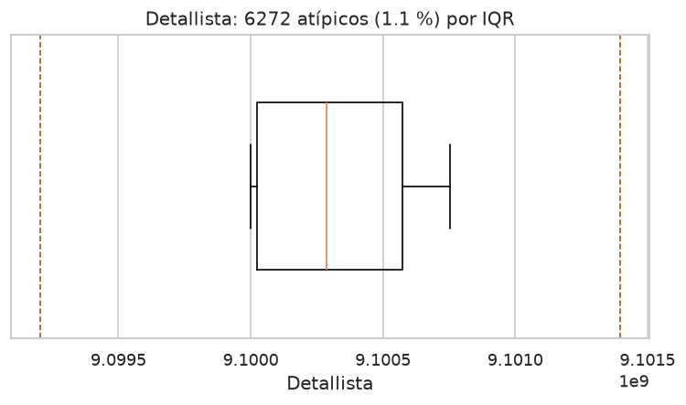 |
| Establecimiento | 7000004735 | 7000028887 | 24152 | 6999968507 … 7000065115 | 154236 (27.9 %) | 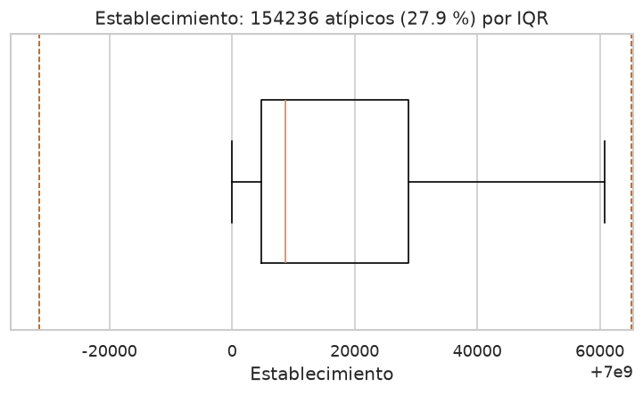 |
| Distribuidor | 100423 | 100865 | 442 | 99760 … 101528 | 76661 (13.9 %) | 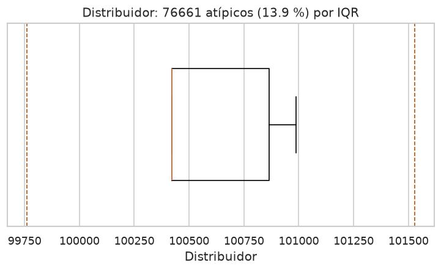 |
| Litros | 7.92 | 54 | 46.08 | -61.2 … 123.1 | 35440 (6.4 %) | 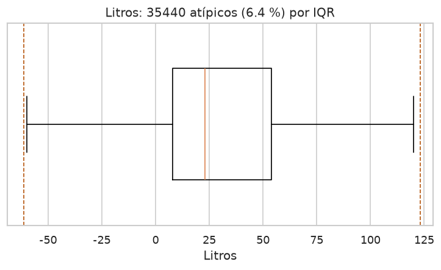 |
| CantidadUMB | 1 | 4 | 3 | -3.5 … 8.5 | 59047 (10.7 %) | 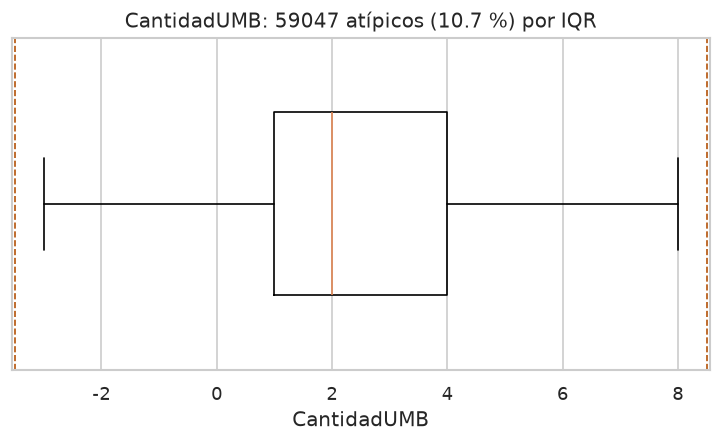 |
| Margen | 7.84 | 52.53 | 44.69 | -59.19 … 119.6 | 69340 (12.5 %) | 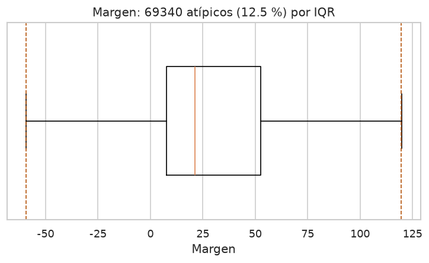 |
| VentaNeta | 18.36 | 79.02 | 60.66 | -72.63 … 170 | 70280 (12.7 %) | 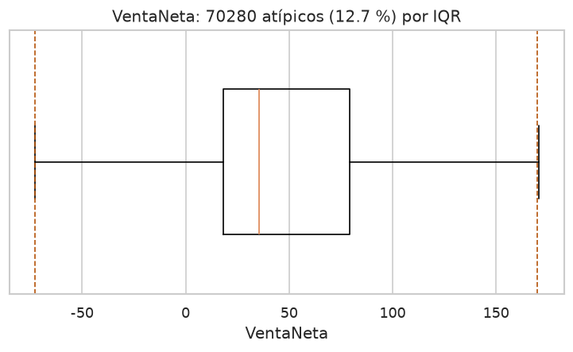 |

## 5. Gráficos

Rutas relativas a este informe, para que los PNG se vean en GitHub.

### Hoja `datos`

Distribución de categóricas:

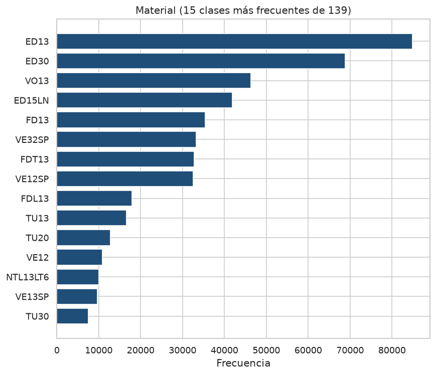

Distribución de numéricas:

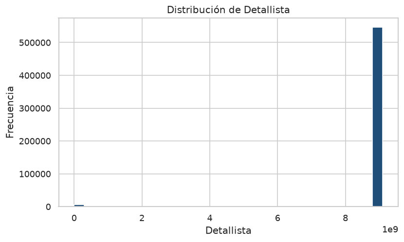

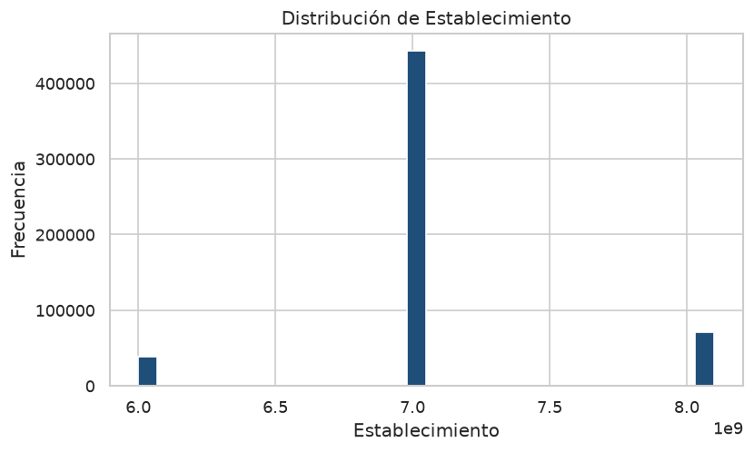

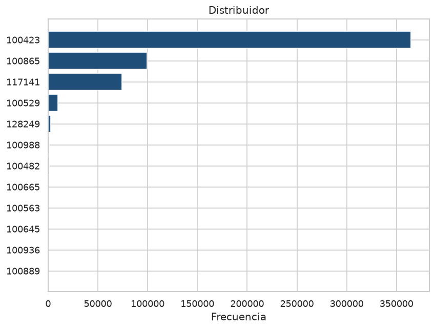

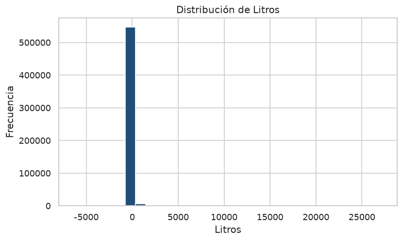

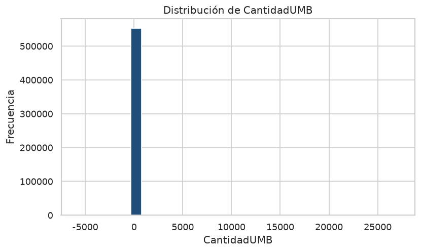

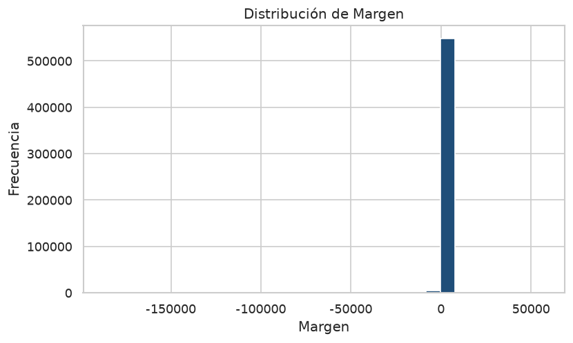

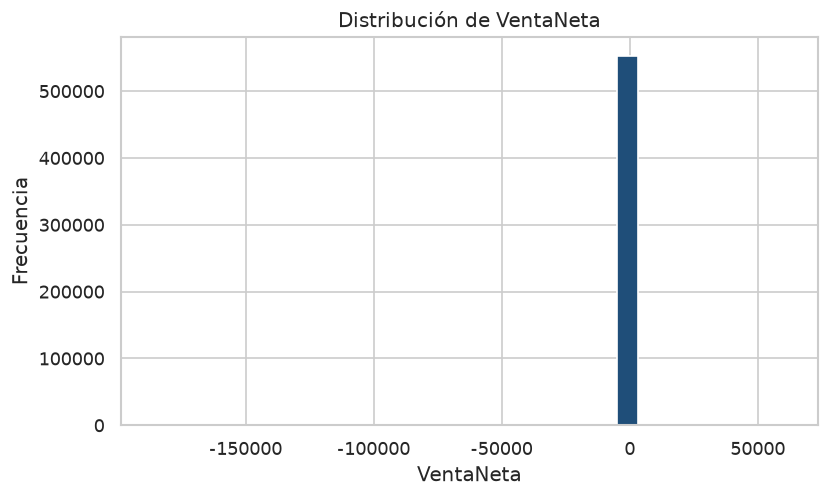

Matriz de correlación y relaciones más fuertes:

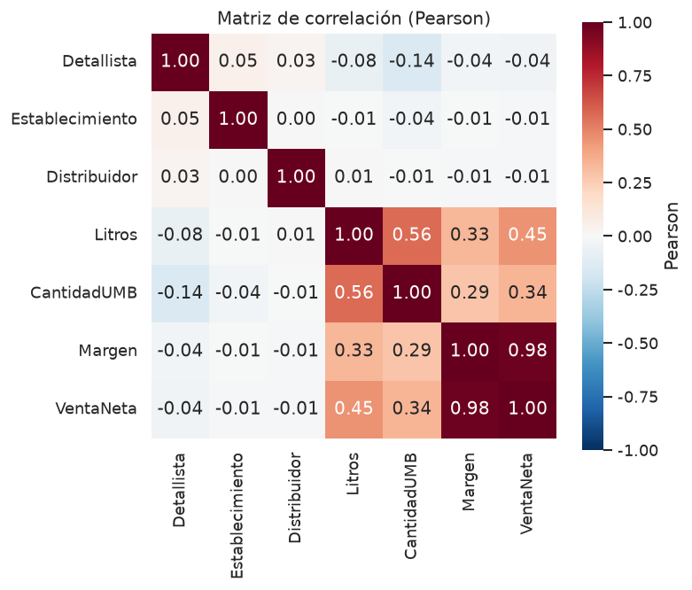

`Margen` y `VentaNeta`: r = 0.98.

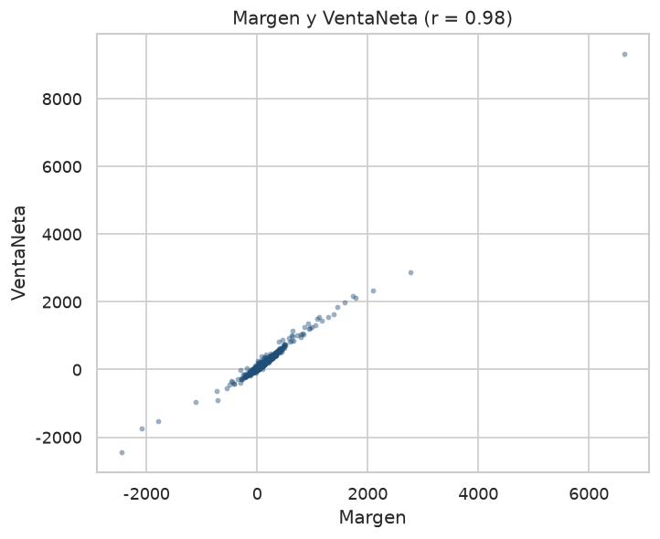

`Litros` y `CantidadUMB`: r = 0.56.

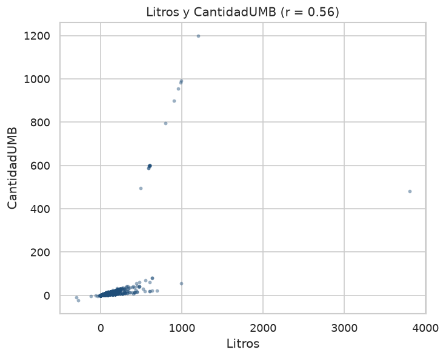

`Litros` y `VentaNeta`: r = 0.45.

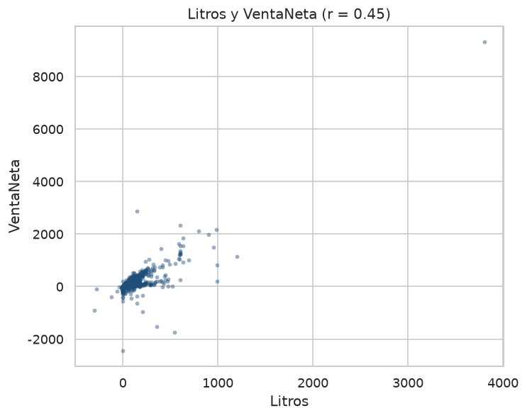

## 6. Conclusiones

La hoja `datos` tiene 553 465 ventas de 2025, una por detallista, establecimiento, material y semana. Cubre las 52 semanas, del 6 de enero al 29 de diciembre, con 4 384 detallistas, 3 844 establecimientos, 12 distribuidores y 139 materiales. No hay nulos ni filas duplicadas. La hoja `info` no tiene filas; el texto de la columna indica que `Establecimiento` enlaza con `EstablecimientoECC` del maestro de establecimientos.

### Hallazgos principales

- Las medidas de negocio son `Litros`, `CantidadUMB`, `Margen` y `VentaNeta`. `Litros` tiene mediana 23,8 L y media 46,1 L. El histograma queda en una sola barra porque el eje va de −6 350 L a 27 168 L. La caja del boxplot está entre 7,9 L y 54 L, y la valla superior del rango intercuartílico queda en 123,1 L.
- Por encima de esa valla hay 35 440 filas (6,4 %). Concentran el 39,0 % de los litros. Son pedidos grandes, sobre todo de materiales como `ED11TC13` (1 796 filas, mediana 599 L y el 4,4 % de los litros).
- `Margen` y `VentaNeta` van casi juntas (r = 0,98): el scatter es una recta que también entra en los valores negativos. La mediana del margen sobre la venta neta es 0,68. `Litros` y `CantidadUMB` correlacionan 0,56, y `Litros` con `VentaNeta` 0,45. El scatter de litros y unidades muestra varios rayos: la mediana son 7,92 L por unidad y el percentil 75 son 18 L, con pocos cocientes distintos según el material. Los identificadores no correlacionan con las ventas.
- `ED13` es el material con más filas (84 868) y el 20,6 % de los litros. `ED30` tiene menos filas y más volumen: el 24,2 %. Los tres distribuidores `100423`, `100865` y `117141` reúnen el 97,3 % de los litros; `100423` solo, el 68,0 %. Junio es el mes con más litros (3,08 millones) y más filas; el resto del año se mueve entre 1,7 y 2,6 millones, con las 52 semanas presentes.

### Problemas de calidad de los datos

- `Detallista`, `Establecimiento` y `Distribuidor` están guardados como números y el criterio IQR los trata como medidas. No lo son. Los 6 272 «atípicos» de `Detallista` (1,1 %) son códigos de 6 dígitos; las otras 547 193 filas usan códigos de 10 dígitos que empiezan por 91. Esos 62 detallistas cortos aportan el 3,5 % de los litros. En `Establecimiento` el IQR marca el 27,9 % de las filas porque los códigos se agrupan en los prefijos 6, 7 y 8 y la valla es muy estrecha. En `Distribuidor`, con 12 códigos, el 13,9 % «atípico» son los distribuidores distintos de los dos centrales.
- Hay 1 537 filas con litros negativos (mínimo −6 350 L) y 1 547 con unidades negativas. Restan el 0,4 % del total de litros. El margen es negativo en el 11,1 % de las filas y la venta neta en el 7,4 %. Una sola fila, material `ED30` con 0 litros y 0 unidades, tiene margen y venta neta iguales a −186 539. Ese valor es el mínimo de las dos columnas y aplasta sus histogramas.
- Hay 31 325 filas con 0 litros. En 31 119 de ellas la venta neta no es cero, y en todas hay margen. No son filas vacías.
- El script no propone quitar ninguna columna. Los códigos hacen falta para unir con el maestro y para agregar.

### Recomendaciones

- Tratar `Detallista`, `Establecimiento` y `Distribuidor` como códigos, no como variables numéricas. Unificar el detallista de 6 y de 10 dígitos antes de cruzar tablas. Conservar las tres columnas: no se ha eliminado ninguna.
- Separar litros, unidades, margen y venta neta en valores positivos, ceros y negativos. Los negativos parecen abonos; los ceros de litros con venta neta informada hay que revisarlos con negocio antes de imputarlos o borrarlos.
- Aislar la fila de −186 539 y no dejar que fije la escala de los gráficos de margen y venta. Para el volumen, resumir con la mediana y con el total de litros. Las 35 440 filas por encima de 123 L contienen el 39 % del volumen y no conviene tirarlas.
- Comparar materiales y distribuidores por litros, no solo por número de filas: `ED30` pesa más que `ED13`. Los meses de 2025 sí son comparables, porque las 52 semanas están en la muestra.
